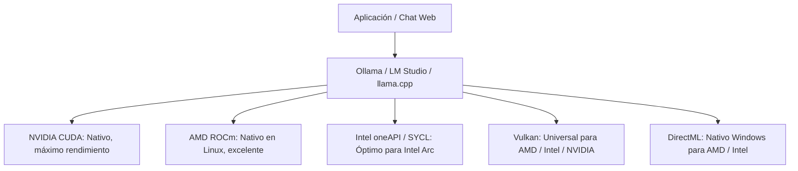

# Fase 3: Ecosistemas de Software, Motores de Inferencia y Comparativa de Rendimiento

**Proyecto:** `H_LLM_IA_BBB`  
**Fecha de corte:** Septiembre 2026  
**Especialistas:** Redactor de Benchmarks & Investigador de Hardware

---

## 1. Motores de Inferencia: ¿Qué software utilizar?

Ejecutar un modelo de lenguaje en tu propia máquina requiere un "motor de inferencia" que cargue los pesos en memoria y ejecute las operaciones matemáticas. Los cuatro motores principales del ecosistema abierto son:

| Motor | Tipo de Interfaz | Facilidad de Uso | Plataformas | Soporte Multi-GPU | Caso de Uso Ideal |
| :--- | :--- | :--- | :--- | :--- | :--- |
| **Ollama** | CLI + API REST de fondo | ⭐⭐⭐⭐⭐ (Instalación en 1 clic) | Windows, Linux, macOS | **Automático:** Reparte capas entre múltiples GPUs (v0.4+) | Usuarios que buscan rapidez, integración con Docker, OpenWebUI o herramientas CLI. |
| **LM Studio** | Aplicación Gráfica Completa (GUI) | ⭐⭐⭐⭐⭐ (Visual e intuitivo) | Windows, macOS, Linux (AppImage) | Manual (ajuste de offload por GPU) | Principiantes en Windows que quieren chatear de inmediato y descargar modelos de Hugging Face sin comandos. |
| **llama.cpp / Kobold.cpp** | Terminal / WebUI ligera | ⭐⭐⭐ (Nivel intermedio/avanzado) | Windows, Linux, macOS | Manual detallado (`--tensor-split`, `--main-gpu`) | Entusiastas que exprimen el 100% del rendimiento (Flash Attention, micro-batching `-ub`). |
| **vLLM** | Servidor de producción | ⭐⭐ (Avanzado, sin interfaz propia) | Linux nativo (o WSL2) | Distribuido avanzado (Ray, PagedAttention) | Servidores multiusuario, homelabs con múltiples usuarios concurrentes y pipelines de agentes intensivos. |

---

## 2. Los Cuatro Caminos de Aceleración Gráfica (Backends)

Dependiendo de la marca de tu tarjeta gráfica y del sistema operativo, el motor se comunicará con el silicio mediante diferentes tecnologías:

### 1. NVIDIA CUDA (El Estándar de la Industria)
- **Sistemas Operativos:** Windows y Linux (máxima paridad).
- **Rendimiento:** 100% de la capacidad de la tarjeta sin pérdidas de traducción.
- **Ventaja:** Cualquier modelo, cuantización o repositorio nuevo se programa y prueba primero en CUDA. Es la experiencia con menor fricción del mercado.

### 2. AMD ROCm / HIP (La Alternativa Potente para Linux)
- **Sistemas Operativos:** Óptimo en **Linux** (Ubuntu 22.04/24.04). En Windows, soporte funcional pero con configuración adicional.
- **Rendimiento:** Prácticamente idéntico a CUDA en tarjetas RDNA 2 y RDNA 3 (RX 6700 XT, RX 7600 XT).
- **Consejo:** Si tienes una tarjeta gráfica AMD Radeon, instalar **Ubuntu Linux** te brindará entre un **25% y 40% más de velocidad** que usar DirectML en Windows.

### 3. Vulkan (El Salvador Universal)
- **Sistemas Operativos:** Windows y Linux.
- **Rendimiento:** Muy cercano a los backends nativos (~85-95%).
- **Ventaja:** Funciona con prácticamente cualquier tarjeta gráfica moderna (NVIDIA antigua, AMD Radeon en Windows sin ROCm, Intel Arc). Viene precompilado en versiones modernas de `llama.cpp` y Kobold.cpp.

### 4. Microsoft DirectML
- **Sistemas Operativos:** Exclusivo de Windows 10/11.
- **Rendimiento:** Más lento que CUDA/ROCm (~60-75% del rendimiento potencial), pero es la solución más sencilla para usar tarjetas AMD o Intel en Windows dentro de LM Studio sin compilar controladores.

---

## 3. Matriz de Benchmarks Empíricos Estimados

Rendimiento medido en **Tokens por Segundo (t/s)** en generación continua (batch size = 1, interacción estándar de chat) con contexto de 4.096 tokens:

| Configuración de Hardware | Inversión Estimada | 3B Q4 (Llama 3.2) | 8B Q4 (Llama 3.1) | 14B Q4 (Qwen 2.5) | 32B Q4 (Qwen 2.5) | Tiempo al Primer Token (TTFT) |
| :--- | :--- | :--- | :--- | :--- | :--- | :--- |
| **NVIDIA RTX 3060 12GB (Windows CUDA)** | ~$200 – $240 | **~120 t/s** | **~50 t/s** | **~27 t/s** | ⚠️ 1.3 t/s (Offload RAM) | Ultrarrápido (< 250 ms) |
| **NVIDIA RTX 2060 12GB (Windows CUDA)** | ~$150 – $190 | **~105 t/s** | **~42 t/s** | **~22 t/s** | ⚠️ 1.2 t/s (Offload RAM) | Rápido (~300 ms) |
| **Intel Arc A770 16GB (Linux SYCL/Vulkan)** | ~$280 – $340 | **~180 t/s** | **~75 t/s** | **~42 t/s** | ⚠️ 1.3 t/s (Offload RAM) | Rápido (~280 ms) |
| **AMD RX 7600 XT 16GB (Linux ROCm)** | ~$320 – $380 | **~115 t/s** | **~48 t/s** | **~26 t/s** | ⚠️ 1.3 t/s (Offload RAM) | Rápido (~310 ms) |
| **AMD RX 7600 XT 16GB (Windows DirectML)**| ~$320 – $380 | **~80 t/s** | **~34 t/s** | **~18 t/s** | ⚠️ 1.1 t/s (Offload RAM) | Moderado (~450 ms) |
| **NVIDIA Tesla P40 24GB (Linux CUDA)** | ~$170 – $230 (+mod) | **~135 t/s** | **~55 t/s** | **~31 t/s** | **~14.5 t/s (100% VRAM)** | Moderado (~400 ms en Pascal)|
| **Dual RTX 3060 12GB (24GB VRAM)** | ~$420 – $480 | **~120 t/s** | **~50 t/s** | **~27 t/s** | **~14.8 t/s (100% VRAM)** | Ultrarrápido (< 300 ms) |
| **Mini PC Ryzen 7 7840HS + 32GB DDR5** | ~$480 – $550 | **~35 t/s** | **~16 t/s** | **~8.5 t/s** | ⚠️ 1.5 t/s (Offload) | Aceptable (~600 ms) |
| **Mini PC Ryzen 7 7840HS + 64GB DDR5** | ~$550 – $620 | **~35 t/s** | **~16 t/s** | **~8.5 t/s** | **~3.6 t/s (Memoria Unificada)**| Aceptable (~750 ms) |

---

## 4. Guía de Selección Rápida: "¿Qué combinación elijo según mi perfil?"

1. **"Quiero empezar hoy mismo sin complicaciones en mi PC con Windows":**  
   $\rightarrow$ **NVIDIA RTX 3060 12GB usada + LM Studio u Ollama.**  
   *Por qué:* Es la experiencia más fluida, sin configurar nada en terminal, con velocidad excelente en modelos de 8B y 14B.
2. **"Tengo un presupuesto muy ajustado (< $200 USD) pero quiero correr modelos de 14B":**  
   $\rightarrow$ **NVIDIA RTX 2060 12GB usada.**  
   *Por qué:* Te da los 12GB reales de VRAM necesarios para saltar a modelos de 14B gastando lo mínimo posible.
3. **"Quiero correr modelos de 32B (Qwen 2.5 32B) al menor costo posible y no me da miedo trastear":**  
   $\rightarrow$ **NVIDIA Tesla P40 24GB usada con adaptador de ventilador 3D.**  
   *Por qué:* 24 GB de VRAM por menos de $230 USD es insuperable.
4. **"Quiero un servidor pequeño, silencioso, que consuma poco y esté encendido 24/7":**  
   $\rightarrow$ **Mini PC AMD Ryzen 7 (7840HS/8845HS) con 64GB DDR5.**  
   *Por qué:* Te permite albergar modelos de hasta 70B de forma compacta y sin tarjetas gráficas dedicadas ruidosas.
