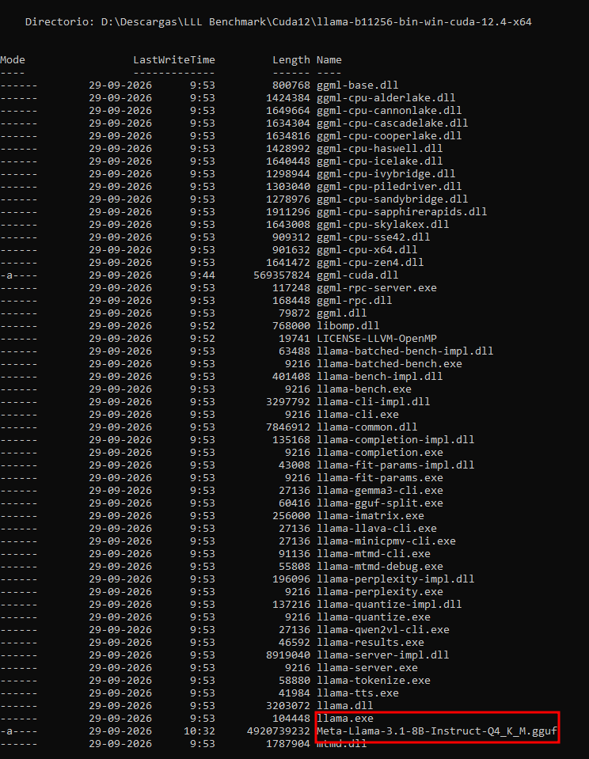
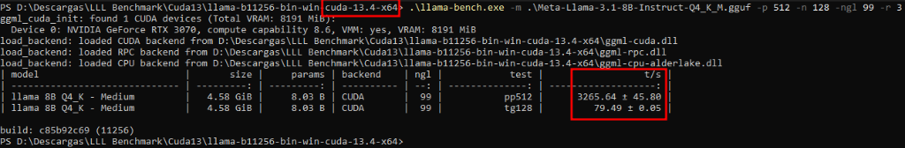
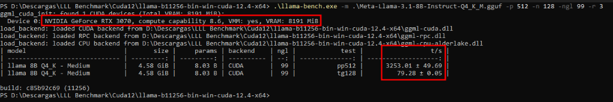
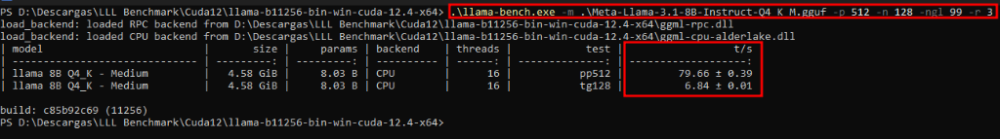
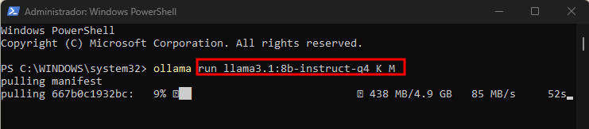

# Guía Práctica de Benchmarking Independiente para LLMs Locales

**Proyecto:** `H_LLM_IA_BBB`  
**Objetivo:** Permitir que cualquier persona, sin importar su nivel técnico, pueda medir de forma autónoma y precisa la velocidad real de su hardware (en tokens por segundo y consumo de memoria) utilizando las herramientas estándar de la industria.

---

## 1. ¿Por qué hacer una prueba independiente con `llama-bench`?

Cuando chateas en una aplicación visual, la velocidad percibida puede variar por el tiempo que tardas en escribir o por la animación del cursor en pantalla.

Para saber con certeza matemática cuánto rinde tu tarjeta gráfica o tu procesador, la comunidad internacional utiliza **`llama-bench`**, la herramienta oficial incluida en el proyecto de código abierto [llama.cpp](https://github.com/ggml-org/llama.cpp).

**Ventajas de `llama-bench`:**
- Hace mediciones repetibles y controladas sin interferencias visuales.
- Separa la prueba en dos métricas clave:
  1. **Velocidad de Lectura (*Prompt Processing* o PP):** Qué tan rápido el modelo procesa tu pregunta inicial o un documento largo.
  2. **Velocidad de Escritura (*Text Generation* o TG):** Qué tan rápido el modelo redacta su respuesta palabra por palabra (esta es la velocidad más importante para conversar fluidamente).

---

## 2. Enlaces Oficiales de Descarga

Para obtener la herramienta en tu equipo:

1. Visita la página oficial de versiones de `llama.cpp`:  
   👉 [https://github.com/ggml-org/llama.cpp/releases](https://github.com/ggml-org/llama.cpp/releases)
2. Descarga el paquete correspondiente a tu tarjeta y sistema operativo:
   - **En Windows con tarjeta NVIDIA:** Descarga el archivo que termina en `bin-win-cuda-cu12.4-x64.zip` (o la versión de CUDA más reciente).
   - **En Windows con tarjeta AMD o Intel:** Descarga el archivo que termina en `bin-win-vulkan-x64.zip`.
   - **En Linux:** Si usas Ubuntu/Debian, descarga el paquete precompilado o compila en 2 minutos con soporte CUDA (`cmake -B build -DGGML_CUDA=ON && cmake --build build --config Release`).
3. Descomprime el archivo en una carpeta de tu preferencia (por ejemplo, `C:\ia-benchmark\` en Windows o `~/ia-benchmark/` en Linux). Dentro encontrarás el archivo ejecutable `llama-bench` (o `llama-bench.exe`).

---

## 3. Descarga del Modelo de Prueba

Para que tu prueba sea comparable con la comunidad, se recomienda usar un modelo estándar en formato `.gguf` cuantizado a `Q4_K_M`:

- **Para tarjetas de 8 GB o 12 GB:**  
  Descarga **Llama 3.1 8B Instruct (Q4_K_M)** desde Hugging Face:  
  👉 [Enlace directo en Hugging Face (Bartowski)](https://huggingface.co/bartowski/Meta-Llama-3.1-8B-Instruct-GGUF)  
  *(Archivo sugerido: `Meta-Llama-3.1-8B-Instruct-Q4_K_M.gguf`, peso aproximado: 4.9 GB).*
- **Para tarjetas de 12 GB o 16 GB:**  
  Descarga **Qwen 2.5 14B Instruct (Q4_K_M)**:  
  👉 [Enlace directo en Hugging Face (Bartowski)](https://huggingface.co/bartowski/Qwen2.5-14B-Instruct-GGUF)  
  *(Archivo sugerido: `Qwen2.5-14B-Instruct-Q4_K_M.gguf`, peso aproximado: 9.0 GB).*

Guarda el archivo `.gguf` en la misma carpeta donde descomprimiste `llama-bench`.

---

## 4. El Comando de Prueba Paso a Paso

Abre una terminal (PowerShell o Símbolo del sistema en Windows; Bash en Linux) en la carpeta donde tienes los archivos y ejecuta el siguiente comando:

### En Windows:
```powershell
.\llama-bench.exe -m .\Meta-Llama-3.1-8B-Instruct-Q4_K_M.gguf -p 512 -n 128 -ngl 99 -r 3
```

### En Linux:
```bash
./llama-bench -m ./Meta-Llama-3.1-8B-Instruct-Q4_K_M.gguf -p 512 -n 128 -ngl 99 -r 3
```

### ¿Qué significa cada parámetro? (Explicación sencilla):
- **`-m [archivo]`**: Le indica la ruta del modelo que va a probar.
- **`-p 512`**: Simula una pregunta de 512 palabras/tokens para medir la velocidad a la que el modelo lee la entrada.
- **`-n 128`**: Pide generar 128 palabras/tokens continuas para medir la velocidad a la que el modelo escribe la respuesta.
- **`-ngl 99`**: Significa *Number of GPU Layers* (Número de capas en la GPU). Al poner 99, le ordenamos que cargue todas las capas posibles en la memoria de la tarjeta gráfica.
- **`-r 3`**: Repite la prueba 3 veces consecutivas para calcular un promedio fiable.

---

## 5. Cómo Interpretar la Tabla de Resultados

Tras unos segundos, la herramienta mostrará una tabla similar a esta:

```text
| model                          |       size |     params | backend | test       |                  t/s |
| ------------------------------ | ---------: | ---------: | ------- | ---------- | -------------------: |
| llama 8B Q4_K - Medium         |   4.58 GiB |     8.03 B | CUDA    | pp512      |       312.45 ± 4.20  |
| llama 8B Q4_K - Medium         |   4.58 GiB |     8.03 B | CUDA    | tg128      |        51.20 ± 0.85  |
```

- **Fila `pp512` (Prompt Processing):** Muestra **~312 tokens/segundo**. Significa que la tarjeta puede leer y procesar textos largos a más de 300 palabras por segundo.
- **Fila `tg128` (Text Generation):** Muestra **~51.20 tokens/segundo**. Este es tu dato principal: el modelo redacta a más de 50 palabras por segundo (lo que equivale a casi 2 páginas de texto en 10 segundos).

---

## 6. Cómo Comprobar el Uso Real de Memoria Durante la Prueba

Para asegurarte de que el modelo cupo por completo en la tarjeta y no está usando la memoria RAM lenta del sistema:

### En Windows:
1. Abre el **Administrador de Tareas** (`Ctrl + Shift + Esc`).
2. Ve a la pestaña **Rendimiento** y selecciona tu **GPU**.
3. Observa la gráfica de **Memoria de GPU dedicada**.  
   - Si tienes una tarjeta de 12 GB y el modelo consume 6.2 GB, la barra se mantendrá estable y el modelo estará corriendo al 100% en la GPU.
   - Si la **Memoria de GPU compartida** empieza a subir, significa que la tarjeta se quedó sin espacio y el modelo se desbordó a la RAM.

### En Linux (o mediante consola en Windows):
Abre una segunda ventana de terminal y ejecuta:
```bash
nvidia-smi
```
Verás de forma instantánea los megabytes exactos ocupados en la tarjeta gráfica y la temperatura de operación.

---

## 7. Método Alternativo Ultrarrápido con Ollama

Si ya tienes **Ollama** instalado y prefieres una medición rápida sin descargar `llama.cpp`:

1. Abre tu terminal y ejecuta tu modelo agregando el parámetro `--verbose`:
   ```bash
   ollama run llama3.1 --verbose
   ```
2. Escribe una pregunta cualquiera (por ejemplo: *"Escribe un ensayo de tres párrafos sobre la historia del hardware"*).
3. Al terminar de responder, Ollama imprimirá automáticamente el resumen técnico:
   - **`prompt eval rate:`** tokens por segundo de lectura.
   - **`eval rate:`** tokens por segundo de escritura (velocidad de generación).

Con estos pasos puedes verificar por tu cuenta cualquier componente que compres o evalúes, contrastándolo con las tablas de esta investigación.

---

## 8. Pruebas de rendimiento en Windows 11 (Intel Core i7-14700, RTX 3070 8GB y 32GB DDR4)

**Componentes del equipo probado:**
- **CPU:** Intel Core i7-14700 (20 núcleos / 28 hilos)
- **RAM:** 32 GB DDR4 @ 3200 MHz en doble canal
- **GPU:** NVIDIA GeForce RTX 3070 8 GB GDDR6 (8.191 MiB VRAM)
- **SO:** Windows 11 (usando Windows PowerShell)
- **Modelo:** `Meta-Llama-3.1-8B-Instruct-Q4_K_M.gguf` (4.58 GB en memoria / 4.92 GB en disco)

### A. Archivos necesarios y organización de carpetas
Al descomprimir `llama.cpp` y colocar el archivo del modelo en la misma carpeta, los comandos son más directos:



### B. Pruebas en la tarjeta gráfica: RTX 3070 8GB (CUDA 13.4 frente a CUDA 12.4)
Subiendo el 100% de capas a la memoria de la tarjeta (`-ngl 99`):

**1. Resultados con CUDA 13.4:**
- Lectura de entrada (`pp512`): **3.265,64 ± 45,80 tokens/s**
- Generación de respuesta (`tg128`): **79,49 ± 0,05 tokens/s**



**2. Resultados con CUDA 12.4:**
- Lectura de entrada (`pp512`): **3.253,01 ± 49,69 tokens/s**
- Generación de respuesta (`tg128`): **79,28 ± 0,05 tokens/s**



*Conclusión en gráfica:* Ambas versiones de CUDA ofrecen prácticamente la misma velocidad (diferencia menor al 0,3%). Escribir a casi 80 tokens por segundo permite completar 128 palabras en 1,6 segundos, con respuesta inmediata.

### C. Prueba en procesador: Intel Core i7-14700 (16 hilos) con memoria RAM DDR4
Ejecución forzada sobre el procesador usando la librería `ggml-cpu-alderlake.dll`:
- Lectura de entrada (`pp512`): **79,66 ± 0,39 tokens/s**
- Generación de respuesta (`tg128`): **6,84 ± 0,01 tokens/s**



*Comparación gráfica vs procesador:* La RTX 3070 es **41 veces más rápida leyendo** y **11,6 veces más rápida respondiendo** que el procesador. Esto ocurre porque la memoria RAM DDR4 transmite datos a unos 51 GB/s, mientras que la memoria GDDR6 de la tarjeta de video transmite a 448 GB/s.

### D. Otra opción en Windows 11: usar Ollama directamente
Descarga e instalación con un comando directo en PowerShell (`ollama run llama3.1:8b-instruct-q4_K_M`), bajando a 85 MB/s y corriendo en la tarjeta sin configurar nada extra:



---
